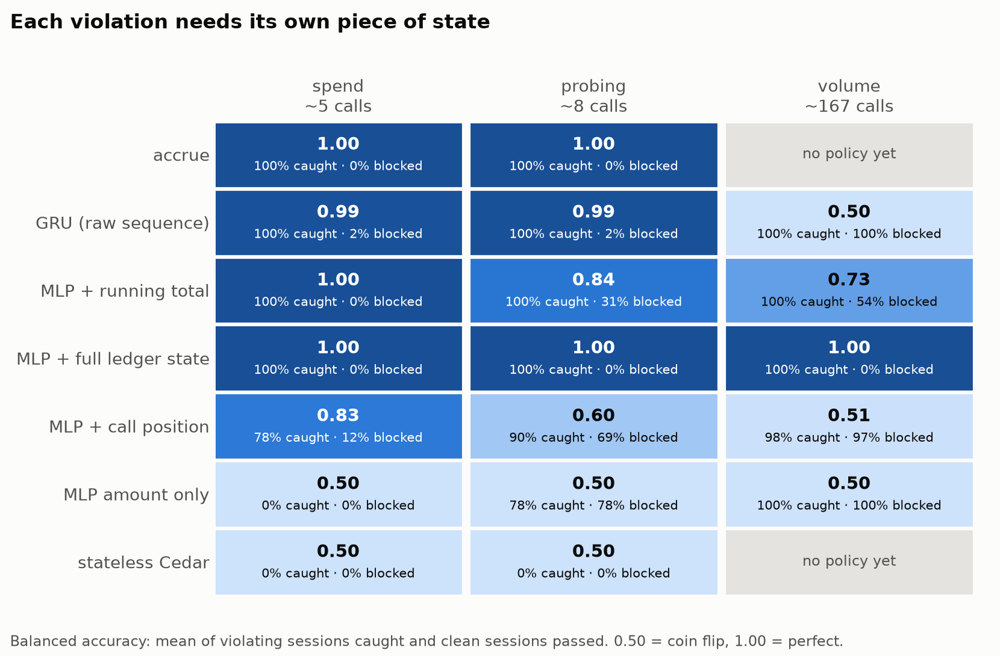
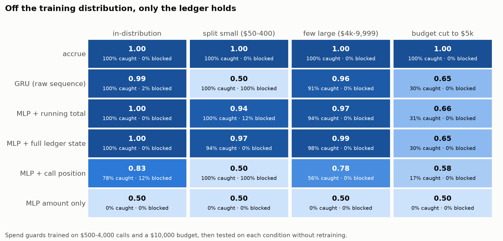
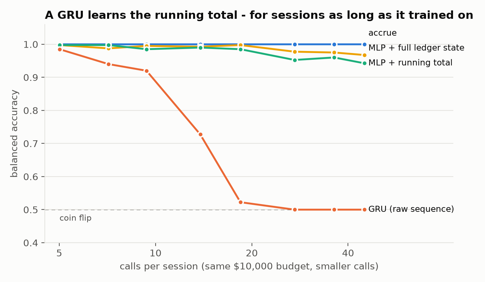
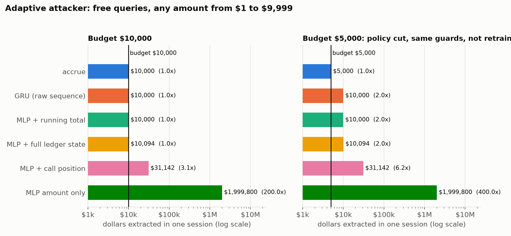

# Per-call baseline

**Question:** could you skip the ledger and just train a model to spot bad
transfers, one call at a time?

**Answer:** no — and not because the model is weak. Give the same neural net
one extra number, the running total, and it goes from catching nothing to
catching everything. The thing missing was never intelligence. It was state.

## Run it

```bash
pip install -r experiments/requirements.txt   # scikit-learn, numpy
python3 -m experiments.per_call_baseline       # needs the cedar CLI on PATH
```

About 15 seconds. `--seed`, `--train-pairs`, `--test-pairs` are adjustable.

## The benchmark

`benchmark.py` builds pairs of transfer sessions. In each pair:

- both sessions are made of calls drawn from the same range ($500–$4,000)
- **every call is individually under the $10,000 budget**
- the violating session is the compliant one plus 1–3 more ordinary calls,
  which push the running total over

So nothing about any single call says "this is the bad one". The only
difference between the two sessions is the total.

It's synthetic on purpose. This is a controlled experiment, not a demo of real
usage — the construction is what lets you tell a *structural* blind spot apart
from a model that just needs more data. `tests/test_benchmark.py` checks the
construction holds, and that the budget matches `src/policies/budget.cedar`.

## Results

200 test pairs, model trained on 600 different pairs. Seed 0:

```
arm                                    call recall  call prec  detected  false-flag    AUC  FF@90%
--------------------------------------------------------------------------------------------------
stateless Cedar (what ships today)            0.00          —        0%          0%      —       —
NN, per-call features                         0.00          —        0%          0%   0.65     74%
NN, + call position                           0.68       0.83       78%         12%   0.92     26%
NN, + running total (ledger state)            0.99       1.00      100%          0%   1.00      0%
accrue: ledger + Cedar                        1.00       1.00      100%          0%      —       —
```

Seeds 1 and 2 give the same picture: per-call AUC 0.64 both times, per-call
FF@90% 74–76%, position-aware detection 79–86%.

- **detected / false-flag** — share of violating / compliant sessions with at
  least one call blocked, at the model's default threshold
- **AUC** — how well the model ranks violating sessions above compliant ones
  across all thresholds (0.5 = coin flip, 1.0 = perfect)
- **FF@90%** — tune the threshold until 90% of violating sessions are caught;
  this is the share of *legitimate* sessions you'd block to get there

## Reading it

**Stateless Cedar catches nothing.** That's the gap this whole repo exists for:
every call is legal on its own, so a per-call rule has nothing to say.

**A neural net with per-call features also catches nothing** at its default
threshold. Forced to catch 90%, it blocks about three quarters of legitimate
sessions too. Unusable.

**Its AUC is 0.65, not 0.5 — and that's worth being honest about.** It isn't
seeing the total. Two side effects of how the benchmark works give it a weak
signal:

1. the call that crosses the budget tends to be larger, since a larger call is
   more likely to be the one that tips it over
2. violating sessions have more calls, and the biggest of more draws tends to
   be bigger

Both are correlations with *size*, not knowledge of the total — which is why
there's no threshold where it's any good.

**Telling it the call's position helps, a lot but not enough.** Later calls are
more likely to be over budget, so a crude hint of history gets it to ~80%
detection — at the cost of blocking 12–18% of legitimate sessions.

**Telling it the running total solves it.** Same network, same training, one
extra feature: perfect. That's the result. The model was never the bottleneck;
the missing input was. And once you have the running total, you don't need a
model at all — `total + amount > budget` is a comparison. That's what accrue
does, deterministically, and it matches the ground truth exactly
(`test_accrue_matches_the_labels_exactly`).

## Limits

- **One policy.** Cumulative spend only — the one rule accrue currently
  enforces through Cedar. Distinct-resource caps and ordering rules aren't
  tested here.
- **Synthetic data, by design.** See above. A real-traffic version needs real
  agent sessions, which this repo doesn't ingest yet.
- **One small model.** A 2×32 MLP. A bigger model doesn't change the argument:
  with only per-call features, the two members of a pair are drawn from the
  same distribution, so there's nothing for any per-call model to learn from.
- **The ground truth matches accrue's own semantics** (deny the crossing call
  and, via the circuit breaker, everything after). A different definition of
  "violating" would need different labels.

---

# Stress suite

**Question:** fine, a per-call model is blind. What about a model with
*memory*, one that learns the running total itself? And what happens once
you stop being nice to it?

**Answer:** a GRU does learn the running total, for sessions shaped like the
ones it trained on. Make the sessions longer, change the budget, or let an
attacker pick the amounts, and every learned guard breaks somewhere. accrue
doesn't, because it isn't approximating anything: it's an addition and a
comparison.

## Run it

```bash
pip install -r experiments/requirements.txt   # adds torch, matplotlib
python3 -m experiments.stress                  # ~12 min on a laptop; needs cedar
python3 -m experiments.figures                 # redraws figures/ from results/stress.json
```

Keep the machine awake (`caffeinate -i python3 -m experiments.stress` on a
Mac): if it sleeps mid-run, the stage timings are meaningless, though the
results aren't affected.

## The arms

Six guards against the same test sessions:

| arm | sees |
|---|---|
| stateless Cedar | this call's amount, through the real `budget.cedar` |
| MLP: amount only | this call's amount |
| MLP: + call position | amount, and which call this is |
| MLP: + running total | amount, and ALLOW-only spend so far (what the ledger stores) |
| MLP: + full ledger state | amount, ALLOW-only spend, and whether anything was denied (the breaker) |
| GRU: raw sequence | the amounts in order, nothing else; any total it wants, it has to learn |
| accrue | the real `authorize_transfer` path: ledger, breaker, Cedar |

The arms that read ledger state are **trained** on the true state but
**scored** on their own decisions, call by call: a call the model flags is
denied and stops counting toward its total, as accrue's would. Scoring them on
the true state instead leaks the answer (it tells the model "a call was
already denied" even when it missed that call itself). An earlier draft of
this suite did that, and it inflated one result from 30% to 70%.

## 1. Each violation needs its own piece of state



- **spend**: the original benchmark: over budget, every call legal on its own.
- **probing**: the session asks for a transfer that crosses the budget,
  gets denied, then sends 2–4 smaller "probes" that each *fit* under the
  remaining headroom. Its compliant twin makes the same probes without the
  denied call. This is what `src/breaker.py` exists for.
- **volume**: a cap of 500 records read per session, 1–5 records per read,
  ~167 calls a session.

**The running total isn't enough for probing.** The probes fit, so a model
reading only the total blocks 31% of clean sessions trying to catch them.
Add "was anything denied?", the breaker's one bit, and it's perfect.

**The GRU can't count to 500.** Over ~167 calls it falls apart (AUC
0.51–0.64 across seeds). What it does at the default threshold varies by
seed, from blocking every session to catching nothing, but it never works.
The same thing happens in spend once sessions get long (section 3).

**Even full ledger state needs its threshold tuned for volume.** It ranks
perfectly in every seed (AUC 1.00), but at the default 0.5 threshold it
blocks 0%, 24% and 32% of clean sessions in seeds 0, 1 and 2. Weighting
the rare class up moves where 0.5 falls.

**accrue has no volume policy yet**, so it gets no credit there. The ledger
already has the count (`aggregates.action_count`); no Cedar rule reads it.

Volume needed two training adjustments, both applied to every arm: 150
training pairs instead of 600 (each volume session is ~30× longer), and the
rare violating calls (0.6% of all calls) weighted up. Without the weighting,
every arm learns "never flag".

## 2. Off the training distribution, only the ledger holds



Spend guards trained on ordinary sessions ($500–4,000 calls, $10,000
budget), then tested without retraining:

- **split small**: $50–400 calls, ~50 per session. The GRU and the position
  model block every clean session. The running-total model blocks 12% in
  seed 0, but 86% and 70% in seeds 1 and 2.
- **few large**: $4,000–9,999 calls, 2–3 per session. The guards that see
  the total miss 0–6% of violating sessions and the position model misses
  44–64%. The GRU is fine in seed 0 but blocks 25–34% of clean sessions in
  seeds 1 and 2.
- **budget cut to $5k**: the policy changes; nobody retrains. Every learned
  guard still enforces the $10,000 line it memorized and catches ~30%: only
  the sessions that happen to cross $10,000 too. For accrue the change is
  one number in `budget.cedar`.

## 3. A GRU learns the running total, for sessions as long as it trained on



Same $10,000 budget, calls scaled down so sessions get longer. Trained on ~5
calls a session, the GRU holds up to ~10 and is a coin flip by ~18–27 in
every seed. The MLP handed the full ledger state degrades gently (0.95–0.97
at ~45 calls). The one handed only the running total depends on the seed:
0.94 at ~45 calls in seed 0 (the run plotted), 0.57 and 0.65 in seeds 1
and 2. Its calls are 10× smaller than anything it trained on, and where it
draws the line out there is luck. accrue doesn't degrade.

## 4. Adaptive attacker



`attack.py` gives the attacker free queries to the guard and any amount
from $1 to $9,999 (each individually legal), up to 200 calls. It tries a
greedy strategy (the largest amount that gets through) and fixed-size
splitting ($50 up to $9,999 repeated) and keeps whichever extracts the most.

- At the trained budget, the amount-only model gives up **$1,999,800**
  (200 × $9,999) and the position model $31,142. The models that see the
  total hold to about $10,000.
- After the budget cut to $5,000, every learned guard still lets $10,000
  through: **2× the budget**. accrue stops at $5,000.

Splitting into small amounts never wins against the GRU. Off-distribution
it *over*-blocks rather than under-blocks, so its failure there is blocking
legitimate users, not losing money (section 2). Losing money shows up when
the budget changes.

## Reading it

The original experiment showed a model is only as good as the state it's
given. The stress suite closes the loophole in that argument: a model that
learns its own state does learn it, but only within the range it trained
on. Policies change, sessions get longer, and attackers choose their
amounts. Each of those takes it out of that range, and the first two need no
adversary at all.

The ledger has no range. "Allowed so far + this call > limit" is exact at
any length, any budget, against any sequence of amounts, and changing the
policy means editing one number.

## Limits

- **Synthetic sessions.** Same caveat as above. The charts show seed 0;
  "Across seeds" below gives ranges over seeds 0–2.
- **Small models, CPU training.** A 2×32 MLP and a 64-unit GRU. A larger
  sequence model would hold up to longer sessions; it would still have a
  length it never saw, and it would still not know about a budget change.
- **The attacker only sees one session.** Spreading spend across sessions
  under one scope is what PR #8's home-scope rollup closes for accrue. The
  learned guards here don't model scopes at all.
- **Volume isn't enforced by accrue yet.** The table shows the gap honestly
  rather than filling it.

## Across seeds

Seeds 0, 1 and 2, each a full run with its own training and test sessions
(`results/stress.json`, `stress-seed1.json`, `stress-seed2.json`).

**Stable in every seed:**

| result | seed 0 | seed 1 | seed 2 |
|---|---|---|---|
| accrue, every condition | 100% caught / 0% blocked | same | same |
| budget cut to $5k: share caught by learned guards | 17–31% | 18–26% | 19–28% |
| GRU balanced accuracy at ~18 / ~27 calls | 0.52 / 0.50 | 0.51 / 0.50 | 0.60 / 0.50 |
| probing: clean sessions blocked, running total only | 31% | 36% | 35% |
| attacker vs. amount-only model | $1,999,800 | $1,999,800 | $1,999,800 |
| attacker vs. state-aware guards, $5k budget | ~$10,000 | ~$10,000 | ~$10,000 |
| attacker vs. accrue, $5k budget | $5,000 | $5,000 | $5,000 |

**Seed 0 was the flattering run** for the learned guards wherever their
inputs went outside the training range. That's the expected way for these
to vary: inside the range the models are well determined, and outside it
they extrapolate however training happened to leave them.

| result | seed 0 | seed 1 | seed 2 |
|---|---|---|---|
| running-total MLP at ~45 calls | 0.94 | 0.57 | 0.65 |
| split small: clean blocked, running-total MLP | 12% | 86% | 70% |
| few large: clean blocked, GRU | 0% | 34% | 25% |
| volume: clean blocked, full ledger state (AUC 1.00 in all) | 0% | 24% | 32% |
